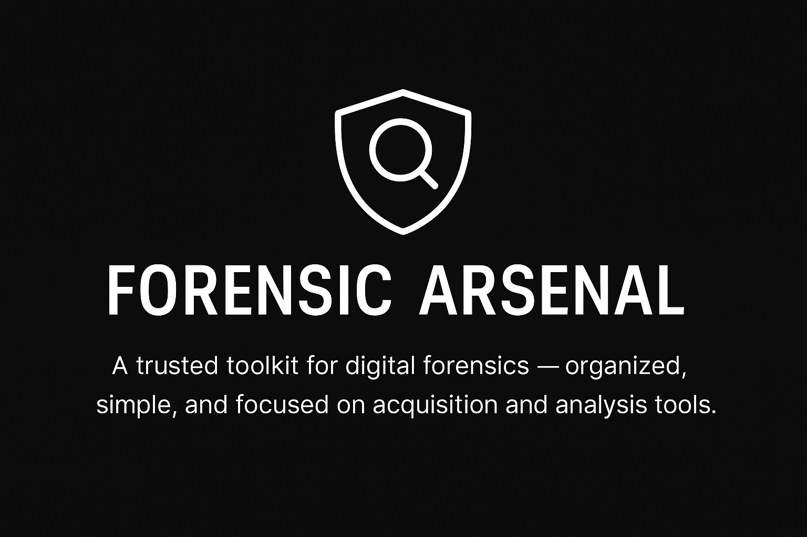

# Forensic Arsenal

**A curated directory of digital forensics and incident response (DFIR) tools, with official download links and concise descriptions.**

[Quick Navigation](#quick-navigation) · [Workflow](#recommended-dfir-workflow) · [Tool Selection Guide](#tool-selection-guide) · [Resources](#useful-resources) · [Contributing](#contributing)

---

## About

Forensic Arsenal collects the tools a DFIR practitioner reaches for most often, organized by investigation domain rather than by vendor. Every entry points to the project's official site, repository, or download page. Where a link is not the vendor's own page, it is marked as such.

> **Use responsibly.** Only analyze evidence you are legally authorized to examine, and always work on verified copies, never on original evidence.

## Table of Contents

- [Quick Navigation](#quick-navigation)
- [Recommended DFIR Workflow](#recommended-dfir-workflow)
- [Tool Selection Guide](#tool-selection-guide)
- [Acquisition and Imaging](#acquisition-and-imaging)
- [Forensic Distributions](#forensic-distributions)
- [Disk and File System Forensics](#disk-and-file-system-forensics)
- [Memory Forensics](#memory-forensics)
- [Windows Forensics](#windows-forensics)
- [Network Forensics](#network-forensics)
- [Mobile Forensics](#mobile-forensics)
- [Malware Analysis](#malware-analysis)
- [Timeline Analysis](#timeline-analysis)
- [Incident Response and Triage](#incident-response-and-triage)
- [Log Analysis and Detection](#log-analysis-and-detection)
- [Threat Intelligence and IOC Analysis](#threat-intelligence-and-ioc-analysis)
- [File Analysis and Utilities](#file-analysis-and-utilities)
- [Useful Resources](#useful-resources)
- [Contributing](#contributing)
- [About the Author](#about-the-author)

## Quick Navigation

| Domain | Typical question it answers |
|--------|-----------------------------|
| [Acquisition and Imaging](#acquisition-and-imaging) | How do I capture evidence without altering it? |
| [Disk and File System Forensics](#disk-and-file-system-forensics) | What is on the disk, including deleted data? |
| [Memory Forensics](#memory-forensics) | What was running on the system when it was captured? |
| [Windows Forensics](#windows-forensics) | What did the user and the OS do on this endpoint? |
| [Network Forensics](#network-forensics) | What crossed the wire? |
| [Mobile Forensics](#mobile-forensics) | What is on this Android or iOS device or backup? |
| [Malware Analysis](#malware-analysis) | What does this sample do? |
| [Timeline Analysis](#timeline-analysis) | In what order did events happen? |
| [Incident Response and Triage](#incident-response-and-triage) | How do I collect quickly at scale? |
| [Log Analysis and Detection](#log-analysis-and-detection) | Where is the suspicious activity in the logs? |
| [Threat Intelligence and IOC Analysis](#threat-intelligence-and-ioc-analysis) | Is this indicator known? |
| [File Analysis and Utilities](#file-analysis-and-utilities) | What is this file, and what are its hashes and metadata? |

## Recommended DFIR Workflow

1. **Evidence acquisition.** Capture volatile data first (memory), then disks, using write-blocked or read-only methods. See [Acquisition and Imaging](#acquisition-and-imaging).
2. **Preservation and integrity.** Hash every image, record the hashes in your notes, and work only on copies. See [Hashing](#file-analysis-and-utilities).
3. **Initial triage.** Identify the OS, time zone, user accounts, and obvious indicators to decide where to look first. See [Incident Response and Triage](#incident-response-and-triage).
4. **Artifact collection.** Pull the artifacts relevant to the question (registry hives, event logs, prefetch, browser data, and so on).
5. **Analysis.** Parse and examine artifacts with the domain tools: [disk](#disk-and-file-system-forensics), [memory](#memory-forensics), [Windows](#windows-forensics), [network](#network-forensics), [malware](#malware-analysis).
6. **Timeline creation.** Merge timestamps from multiple sources into one sequence. See [Timeline Analysis](#timeline-analysis).
7. **Correlation.** Cross-check findings between sources and against [threat intelligence](#threat-intelligence-and-ioc-analysis).
8. **Reporting.** Document scope, methods, tool versions, hashes, findings, and limitations so the work can be reproduced.

## Tool Selection Guide

| Investigation type | Start with |
|--------------------|------------|
| **Disk investigation** | [Acquisition and Imaging](#acquisition-and-imaging) → [Disk and File System Forensics](#disk-and-file-system-forensics) → [Timeline Analysis](#timeline-analysis) |
| **Memory investigation** | [Memory acquisition](#acquisition-and-imaging) → [Memory Forensics](#memory-forensics) → [Malware Analysis](#malware-analysis) |
| **Windows endpoint investigation** | [Incident Response and Triage](#incident-response-and-triage) → [Windows Forensics](#windows-forensics) → [Log Analysis and Detection](#log-analysis-and-detection) |
| **Network investigation** | [Network Forensics](#network-forensics) → [Threat Intelligence and IOC Analysis](#threat-intelligence-and-ioc-analysis) |
| **Malware investigation** | [File Analysis and Utilities](#file-analysis-and-utilities) → [Malware Analysis](#malware-analysis) → [Memory Forensics](#memory-forensics) |
| **Mobile investigation** | [Mobile Forensics](#mobile-forensics) → [Timeline Analysis](#timeline-analysis) |

---

## Acquisition and Imaging

Tools for capturing disk images, memory, and live-system data.

### Disk Imaging

| Tool | Description | Platform | Type | Link |
|------|-------------|----------|------|------|
| FTK Imager | Creates forensic disk images and previews data without altering it. | Windows | GUI / CLI | [Download](https://www.exterro.com/ftk-product-downloads/) |
| Magnet Acquire | Captures forensic images of computers and mobile devices. | Windows | GUI | [Download](https://www.magnetforensics.com/resources/getting-started-magnet-acquire-community-edition/) |
| OSFClone | Bootable tool to image drives without modifying the source disk. | Bootable (Linux) | CLI | [Download](https://www.osforensics.com/tools/create-disk-images.html) |
| Guymager | Fast forensic imager with a GUI. | Linux | GUI | [Download](https://guymager.sourceforge.io/) |
| dc3dd | Enhanced `dd` with built-in hashing and logging. | Linux | CLI | [Download](https://sourceforge.net/projects/dc3dd/) |
| AIR | Graphical front end for `dd` and `dc3dd`. | Linux | GUI | [Download](https://sourceforge.net/projects/air-imager/) |

### Memory Acquisition

| Tool | Description | Platform | Type | Link |
|------|-------------|----------|------|------|
| Belkasoft RAM Capturer | Lightweight physical memory (RAM) capture. | Windows | GUI | [Download](https://belkasoft.com/ram-capturer) |
| Magnet DumpIt | Memory acquisition for live Windows systems. | Windows | CLI | [Download](https://www.magnetforensics.com/resources/magnet-dumpit-for-windows/) |
| WinPmem | Open-source physical memory acquisition driver and tool. | Windows | CLI | [GitHub](https://github.com/Velocidex/WinPmem) |
| LiME | Loadable kernel module for Linux and Android memory acquisition. | Linux / Android | Kernel module | [GitHub](https://github.com/504ensicsLabs/LiME) |
| AVML | Userland Linux memory acquisition tool from Microsoft. | Linux | CLI | [GitHub](https://github.com/microsoft/avml) |

## Forensic Distributions

Prebuilt environments with many tools preconfigured.

| Tool | Description | Platform | Type | Link |
|------|-------------|----------|------|------|
| CAINE | Complete Linux forensic environment for acquisition and analysis. | Bootable (Linux) | Live distro | [Download](https://www.caine-live.net/) |
| PALADIN | Bootable Linux distro with forensic tools, imaging-focused. | Bootable (Linux) | Live distro | [Download](https://sumuri.com/software/paladin/) |
| SIFT Workstation | SANS forensic toolkit environment for Linux. | Linux | Distro / toolkit | [Official page](https://www.sans.org/tools/sift-workstation/) |
| FLARE VM | Windows malware-analysis environment installer from Mandiant. | Windows | Installer script | [GitHub](https://github.com/mandiant/flare-vm) |

## Disk and File System Forensics

| Tool | Description | Platform | Type | Link |
|------|-------------|----------|------|------|
| Autopsy | GUI forensic platform to analyze hard drives and smartphones. | Windows / Linux | GUI | [Official](https://www.autopsy.com/) |
| The Sleuth Kit | Command-line library and tools for disk image and file system analysis; the engine behind Autopsy. | Windows / Linux / macOS | CLI | [Official](https://www.sleuthkit.org/) |
| Bulk Extractor | Scans images and extracts emails, URLs, credit card numbers, and more without parsing the file system. | Windows / Linux | CLI | [Download](https://digitalcorpora.org/downloads/bulk_extractor/) |
| PhotoRec / TestDisk | File carving and partition/deleted-file recovery. | Windows / Linux / macOS | CLI | [Official](https://www.cgsecurity.org/) |
| MFTECmd | Parses NTFS `$MFT`, `$J`, `$Boot`, and related artifacts. | Windows | CLI | [Download](https://ericzimmerman.github.io/) |

## Memory Forensics

| Tool | Description | Platform | Type | Link |
|------|-------------|----------|------|------|
| Volatility | Memory forensics framework for analyzing RAM dumps. | Windows / Linux | Framework (CLI) | [Official](https://www.volatilityfoundation.org/) |
| Volatility 3 | Current Python 3 generation of the Volatility framework. | Windows / Linux / macOS | Framework (CLI) | [GitHub](https://github.com/volatilityfoundation/volatility3) |

## Windows Forensics

### Registry and Execution Artifacts

| Tool | Description | Platform | Type | Link |
|------|-------------|----------|------|------|
| Registry Explorer | Browse and analyze Windows Registry hives. | Windows | GUI | [Download](https://ericzimmerman.github.io/) |
| RegRipper | Extracts and summarizes forensic data from registry hives via plugins. | Windows / Linux | CLI | [GitHub](https://github.com/keydet89/RegRipper3.0) |
| ShellBags Explorer | Analyze shellbag artifacts to track folder access. | Windows | GUI | [Download](https://ericzimmerman.github.io/) |
| PECmd | Parses Windows Prefetch (`.pf`) files for process-execution artifacts. | Windows | CLI | [Download](https://ericzimmerman.github.io/) |
| AmcacheParser | Parses the Amcache hive for program execution evidence. | Windows | CLI | [Download](https://ericzimmerman.github.io/) |
| AppCompatCacheParser | Parses ShimCache (AppCompatCache) data. | Windows | CLI | [Download](https://ericzimmerman.github.io/) |
| JLECmd | Parses Jump List files. | Windows | CLI | [Download](https://ericzimmerman.github.io/) |
| LECmd | Parses LNK (shortcut) files. | Windows | CLI | [Download](https://ericzimmerman.github.io/) |
| SrumECmd | Parses SRUM (System Resource Usage Monitor) data. | Windows | CLI | [Download](https://ericzimmerman.github.io/) |

### Event Logs

| Tool | Description | Platform | Type | Link |
|------|-------------|----------|------|------|
| Event Log Explorer | View and analyze Windows event logs. | Windows | GUI | [Official](https://eventlogxp.com/) |
| EvtxECmd | Parses `.evtx` event logs to CSV/JSON with normalized maps. | Windows | CLI | [Download](https://ericzimmerman.github.io/) |

### Browser Artifacts

| Tool | Description | Platform | Type | Link |
|------|-------------|----------|------|------|
| Hindsight | Analyzes Chromium-based browser artifacts (history, cookies, downloads). | Windows / Linux / macOS | CLI / Web UI | [GitHub](https://github.com/obsidianforensics/hindsight) |
| BrowsingHistoryView | Aggregates browsing history from several browsers. | Windows | GUI | [Official](https://www.nirsoft.net/utils/browsing_history_view.html) |

> The Eric Zimmerman tools above are all published from one page: <https://ericzimmerman.github.io/>.

## Network Forensics

| Tool | Description | Platform | Type | Link |
|------|-------------|----------|------|------|
| Wireshark | Packet capture and protocol analyzer. | Windows / Linux / macOS | GUI / CLI | [Official](https://www.wireshark.org/) |
| NetworkMiner | Passive network sniffer and session/file reassembler. | Windows / Linux | GUI | [Download](https://www.netresec.com/?page=NetworkMiner) |
| Zeek | Network security monitor that turns traffic into structured logs. | Linux / macOS | Framework | [Official](https://zeek.org/) |
| Arkime | Large-scale full packet capture and indexed PCAP search. | Linux | Platform | [Official](https://arkime.com/) |

## Mobile Forensics

| Tool | Description | Platform | Type | Link |
|------|-------------|----------|------|------|
| ALEAPP | Android Logs, Events, And Protobuf Parser for extracted Android data. | Windows / Linux / macOS | Script / GUI | [GitHub](https://github.com/abrignoni/ALEAPP) |
| iLEAPP | iOS Logs, Events, And Plists Parser for extracted iOS data. | Windows / Linux / macOS | Script / GUI | [GitHub](https://github.com/abrignoni/iLEAPP) |
| MVT | Mobile Verification Toolkit for spotting indicators of compromise on Android and iOS. | Linux / macOS | CLI | [GitHub](https://github.com/mvt-project/mvt) |

Magnet Acquire (see [Disk Imaging](#disk-imaging)) also supports mobile device acquisition.

## Malware Analysis

| Tool | Description | Platform | Type | Link |
|------|-------------|----------|------|------|
| Ghidra | Software reverse-engineering suite with a decompiler. | Windows / Linux / macOS | GUI | [Official](https://ghidra-sre.org/) |
| Detect It Easy | Identifies file types, packers, and compilers. | Windows / Linux / macOS | GUI / CLI | [GitHub](https://github.com/horsicq/Detect-It-Easy) |
| PEStudio | Static inspection of Windows executables for suspicious indicators. | Windows | GUI | [Official](https://www.winitor.com/) |
| capa | Identifies capabilities in executable files using rules. | Windows / Linux / macOS | CLI | [GitHub](https://github.com/mandiant/capa) |
| CAPEv2 | Self-hosted malware sandbox for automated dynamic analysis and config extraction. | Linux (host) | Sandbox | [GitHub](https://github.com/kevoreilly/CAPEv2) |
| Sysinternals Suite | Process Monitor, Process Explorer, Autoruns, and related system tools used for dynamic analysis. | Windows | GUI / CLI | [Official](https://learn.microsoft.com/en-us/sysinternals/) |

## Timeline Analysis

| Tool | Description | Platform | Type | Link |
|------|-------------|----------|------|------|
| Plaso (log2timeline) | Builds super-timelines from many artifact sources. | Windows / Linux / macOS | CLI | [GitHub](https://github.com/log2timeline/plaso) |
| Timeline Explorer | Visualize and filter CSV-based forensic timelines. | Windows | GUI | [Download](https://ericzimmerman.github.io/) |
| Timesketch | Collaborative forensic timeline analysis platform. | Linux (server) | Web platform | [Official](https://timesketch.org/) |

## Incident Response and Triage

| Tool | Description | Platform | Type | Link |
|------|-------------|----------|------|------|
| Velociraptor | Endpoint visibility and collection at scale using queries (VQL). | Windows / Linux / macOS | Platform | [Official](https://docs.velociraptor.app/) |
| KAPE | Fast targeted artifact collection and parsing. | Windows | CLI / GUI | [Official](https://www.kroll.com/en/services/cyber-risk/incident-response-litigation-support/kroll-artifact-parser-extractor-kape) |
| CyLR | Collects forensic artifacts from endpoints quickly. | Windows / Linux / macOS | CLI | [GitHub](https://github.com/orlikoski/CyLR) |
| UAC | Unix-like Artifacts Collector for Linux, macOS, and other Unix systems. | Linux / macOS / Unix | Shell script | [GitHub](https://github.com/tclahr/uac) |

## Log Analysis and Detection

| Tool | Description | Platform | Type | Link |
|------|-------------|----------|------|------|
| Hayabusa | Fast Windows event log timeline generator and threat-hunting tool. | Windows / Linux / macOS | CLI | [GitHub](https://github.com/Yamato-Security/hayabusa) |
| Chainsaw | Rapid search and hunting through Windows event logs using Sigma rules. | Windows / Linux / macOS | CLI | [GitHub](https://github.com/WithSecureLabs/chainsaw) |
| Sigma | Generic, open signature format and rule repository for log detection. | Platform-agnostic | Rules | [GitHub](https://github.com/SigmaHQ/sigma) |

## Threat Intelligence and IOC Analysis

| Tool | Description | Platform | Type | Link |
|------|-------------|----------|------|------|
| VirusTotal | Online scanning and reputation lookup for files, URLs, domains, and IPs. | Web | Online service | [Official](https://www.virustotal.com/) |
| MISP | Open-source platform for sharing threat intelligence and IOCs. | Linux (server) | Platform | [Official](https://www.misp-project.org/) |

> Never upload sensitive or client evidence to public online services.

## File Analysis and Utilities

| Tool | Description | Platform | Type | Link |
|------|-------------|----------|------|------|
| HxD Hex Editor | Low-level disk and binary editor. | Windows | GUI | [Official](https://mh-nexus.de/en/hxd/) |
| ExifTool | Reads, writes, and extracts file metadata. | Windows / Linux / macOS | CLI | [Official](https://exiftool.org/) |
| YARA | Pattern-matching engine for identifying and classifying malware and files. | Windows / Linux / macOS | CLI | [GitHub](https://github.com/VirusTotal/yara) |
| hashdeep | Computes and audits multiple hashes (MD5, SHA-256, and others) across files. | Windows / Linux / macOS | CLI | [GitHub](https://github.com/jessek/hashdeep) |
| CyberChef | Browser-based tool for decoding, decompressing, and transforming data. | Web (runs locally in browser) | Web app | [Official](https://gchq.github.io/CyberChef/) |

---

## Useful Resources

| Resource | Why it is useful |
|----------|------------------|
| [SANS DFIR Resources](https://www.sans.org/digital-forensics-incident-response/) | Cheat sheets, posters, and training information from SANS. |
| [Forensic Artifacts (ForensicArtifacts.com)](https://forensicartifacts.com/) | Reference for where forensic artifacts live on different systems. |
| [MITRE ATT&CK](https://attack.mitre.org/) | Knowledge base of adversary tactics and techniques for mapping findings. |
| [Digital Corpora](https://digitalcorpora.org/) | Public disk images, memory images, and corpora for practice. |
| [The DFIR Report](https://thedfirreport.com/) | Real-world intrusion write-ups with timelines and artifacts. |
| [Eric Zimmerman's Tools](https://ericzimmerman.github.io/) | Widely used Windows artifact parsers (many are listed above). |

## Contributing

Contributions are welcome: new tools, fixes for broken links, and corrections. Read [CONTRIBUTING.md](CONTRIBUTING.md) first, then either open a pull request or use an issue form:

- [Suggest a new tool](../../issues/new?template=new-tool.yml)
- [Report a broken link](../../issues/new?template=broken-link.yml)

## About the Author

This project is created and maintained by [0xgbreil](https://www.linkedin.com/in/0xgbreil/).
Feel free to connect on LinkedIn or explore other projects on [GitHub](https://github.com/0xgbreil).
